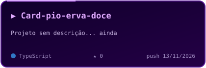
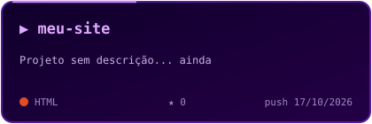
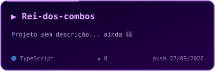
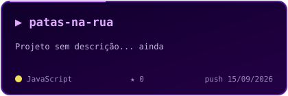
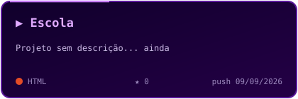
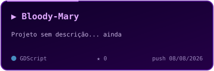
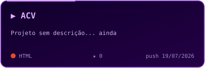
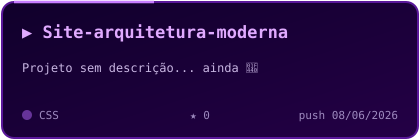

<div align="center">


<a href="https://git.io/typing-svg"></a>


</div>

## Player Status

```yaml
HP   : ████████████████████████  100%
MP   : ████████████████████████  100%
EXP  : ██████████████████░░░░░░   75%  (LVL 24)

Nome   : Brenim
Classe : Full-Stack Developer / Game Developer
Quest  : Desenvolver um jogo pro meu TCC
Buff   : Cafeína + Dark Mode
```

## Quest Log (meus repositórios)

<div align="center">

<!-- REPOS:INICIO -->
<a href="https://github.com/Brenno1234567/Card-pio-erva-doce"></a>
<a href="https://github.com/Brenno1234567/meu-site"></a>
<a href="https://github.com/Brenno1234567/Rei-dos-combos"></a>
<a href="https://github.com/Brenno1234567/patas-na-rua"></a>
<a href="https://github.com/Brenno1234567/Escola"></a>
<a href="https://github.com/Brenno1234567/Bloody-Mary"></a>
<a href="https://github.com/Brenno1234567/ACV"></a>
<a href="https://github.com/Brenno1234567/Site-arquitetura-moderna"></a>
<!-- REPOS:FIM -->

<br/><br/>

<a href="https://github.com/Brenno1234567?tab=repositories"></a>

## Multiplayer

<a href="https://discord.gg/xfyYgfBb"></a>
<a href="https://s.team/p/jjfb-tjvq/CGKCDPVK"></a>
<a href="https://www.instagram.com/brenno_firmino08"></a>

</div>
